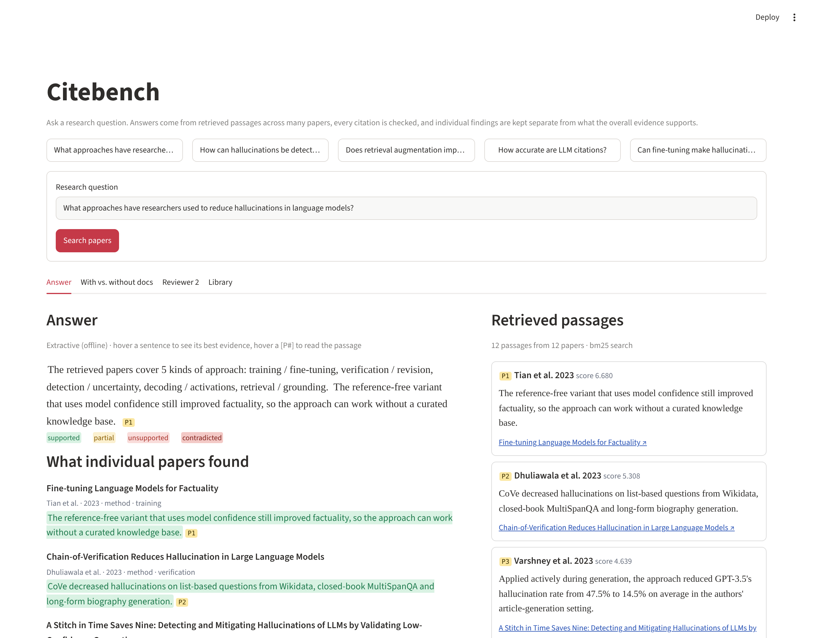
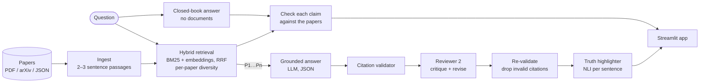
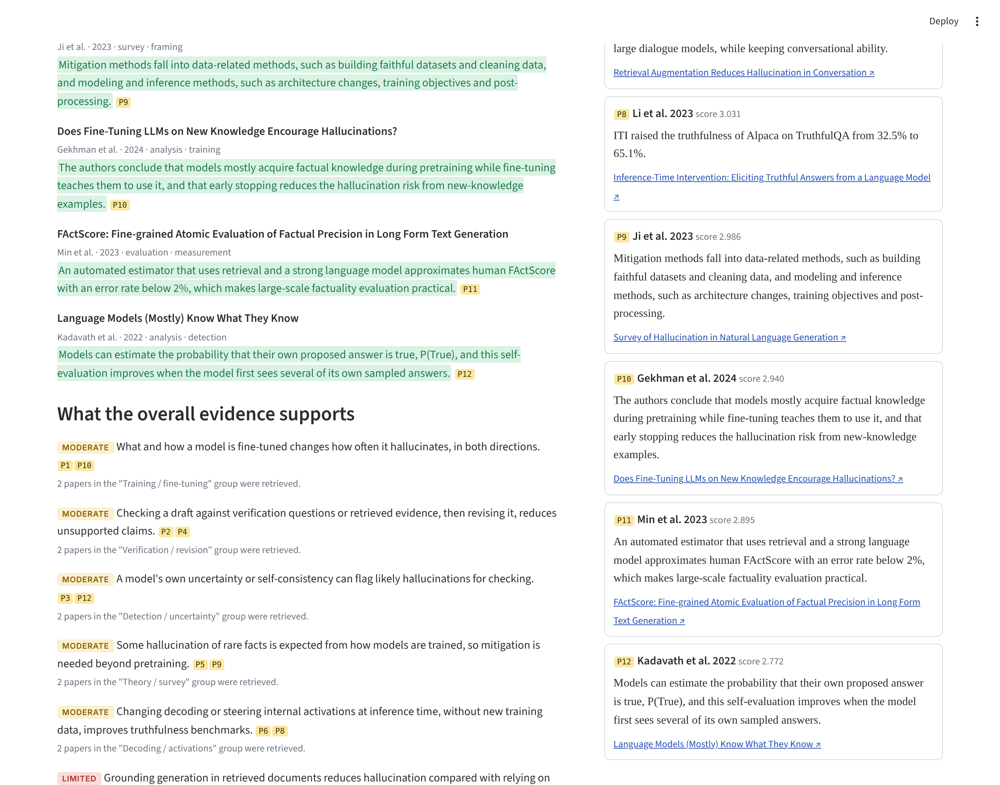
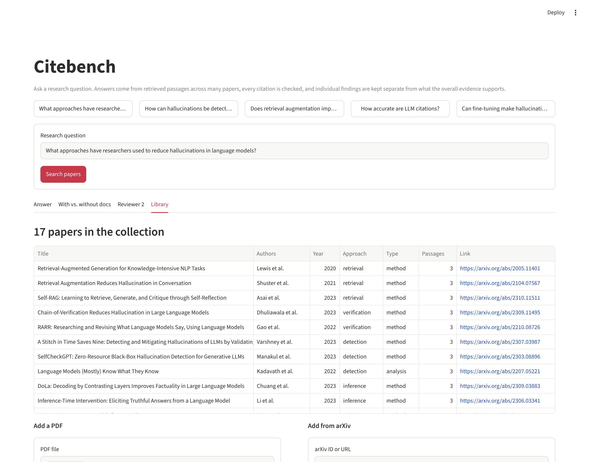

# Citebench: Research Paper Summarizer with Checked Citations

Ask a research question, such as *"What approaches have researchers used to reduce hallucinations in language models?"*. Citebench retrieves passages from many papers, writes an answer in which every claim cites a passage, checks those citations in code, and keeps **what each paper found** separate from **what the overall evidence supports**.



## Features

| | What it does | Where |
|---|---|---|
| **Multi-document retrieval** | Hybrid BM25 + dense embeddings merged with reciprocal rank fusion. It takes the best passage from each paper before any second passage, so answers draw on many papers. | `citebench/retrieval.py` |
| **Grounded answers** | The LLM sees only labelled passages (P1, P2, …) and returns JSON: a cited summary, per-paper findings, cross-paper evidence rated *strong / moderate / limited*, tensions and gaps. | `citebench/generate.py` |
| **Citation validator** | Flags made-up citations, findings that cite another paper's passage, findings about papers that weren't retrieved, weak support, uncited claims, numbers the cited passages don't contain, and evidence rated stronger than its distinct papers allow (lowered automatically). | `citebench/validate.py` |
| **Truth highlighter** | Scores each answer sentence against its cited passages with an NLI cross-encoder and labels it supported, partial, unsupported or contradicted. Hovering shows the exact source sentence. | `citebench/nli.py` |
| **With docs vs. without docs** | Asks the same question with no documents, splits that answer into atomic claims, and checks each against the whole collection: backed, partial, not in papers, or contradicted. | `citebench/compare.py` |
| **Reviewer 2** | A second pass critiques the draft for overclaiming, cherry-picking, misread numbers and inflated ratings, then a revise pass fixes it. | `citebench/review.py` |
| **Library** | Add papers from PDF or arXiv. A 17-paper starter set on LLM hallucination is included. | `citebench/ingest.py` |
| **Offline mode** | Without an API key, answers are extractive (each paper's best sentence) and every check still runs. | |

## How it works



The design follows one rule: **the LLM is anchored to the documents but never trusted.** Instructions reduce hallucinated citations without removing them, so every citation is checked in code before the answer is shown.

## Results

All numbers come from scripts in `eval/` and are written up in [docs/EVALUATION.md](docs/EVALUATION.md) (retrieval and planted errors), [docs/EVALUATION_models.md](docs/EVALUATION_models.md) (same, with the real embedding and NLI models) and [docs/EVALUATION_LLM.md](docs/EVALUATION_LLM.md) (full pipeline with a real LLM, plus a hand audit).

### Full pipeline with Qwen 2.5 7B (free, local via Ollama, RTX 4060 laptop)

15 questions, about 19 s each.

| Measure | Result |
|---|---|
| Citations Qwen wrote | 71 |
| Made up, or pointing at another paper's passage | **0** |
| Evidence ratings stronger than the cited papers allow (lowered automatically) | 9 |
| Cited sentences actually supported by their passages (hand audit of 38) | **82%** |
| Real problems in those sentences (overclaims, off-topic citations) caught by the truth highlighter | **7 of 7** |
| Correct sentences the highlighter wrongly flagged | 35% (48% before a fix made after the audit) |
| Memory-only claims citing a specific study or figure, none backed by the papers | 16 of 76 |

Grounding works: with the papers in front of it, Qwen made no made-up citations. From memory, it credited invented findings to real authors, for example a 75% "LLM citation accuracy" figure attributed to the GPT-3 paper. The highlighter catches the real problems but is too strict with a small NLI model. Reviewer 2 running on the same 7B model accepted every answer, so the deterministic checks do the useful work.

### Retrieval (15 hand-labelled questions)

| Setting | Recall@5 | Recall@12 | MRR | Distinct papers in top 12 |
|---|---|---|---|---|
| Hybrid: BM25 + bge-small embeddings | 76% | **96%** | 0.93 | 12.0 |
| BM25 only | 75% | 87% | 0.94 | 11.1 |
| BM25 without per-paper diversity | 75% | 77% | 0.93 | 7.1 |

### Citation checks on 705 planted errors

Made-up citations, wrong-paper citations, unrelated claims and negated claims are all caught 100% of the time; changed numbers 98–100%; single-paper "strong" ratings 100%. There were 0% false alarms on correct findings, though those were copied word for word from the passages, which is the easy case. The first run caught 86%, and the number and negation checks were added in response. These checks were designed after seeing the planted errors, so treat these numbers as optimistic. The hand audit above is the more realistic measure.

**What evaluation changed.** Each real-model run surfaced a problem the synthetic tests had missed:
- Paper names not matched to papers: relevant papers in answers went from 10% to 43%.
- Unrelated passages counted as "contradictions": 33 of 79 memory-only claims fell to 4.
- Reference years like "(2024)" flagged as wrong numbers.
- Close restatements rejected by the NLI model.

## Quick start

```bash
git clone https://github.com/AbhishekNadar1891/research-paper-summarizer
cd research-paper-summarizer
python -m venv .venv && source .venv/bin/activate      # Windows: .venv\Scripts\activate
pip install -r requirements.txt
cp .env.example .env          # choose an LLM (see below), or leave it for offline mode
streamlit run app.py
```

### Choosing an LLM

| Option | Cost | Setup in `.env` |
|---|---|---|
| **Ollama (local)** | Free, no key, runs on your GPU/CPU | Install [Ollama](https://ollama.com), run `ollama pull qwen2.5:7b`, set `CITEBENCH_PROVIDER=ollama` |
| **Claude** | Paid API | `CITEBENCH_PROVIDER=anthropic`, `ANTHROPIC_API_KEY=...` |
| **OpenAI-compatible** (Groq, OpenRouter, DeepSeek, …) | Free tiers on some | `CITEBENCH_PROVIDER=openai_compatible`, `CITEBENCH_BASE_URL`, `CITEBENCH_API_KEY`, `CITEBENCH_MODEL` |

A 7B model such as `qwen2.5:7b` needs about 5 GB of GPU memory, or 8 GB+ of RAM on CPU. Citebench raises Ollama's context window to 8k tokens so a dozen passages fit, and asks every provider for JSON output. You can also paste a Claude API key into the app's sidebar for one session. On the first run, the embedding model (`BAAI/bge-small-en-v1.5`) and NLI model (`cross-encoder/nli-deberta-v3-small`) download from Hugging Face. If they can't load, the app falls back to BM25-only search and a lexical scorer.

```bash
pytest                                    # 84 tests, no network or API key needed
python eval/run_eval.py                   # retrieval + planted-error checks -> docs/EVALUATION.md
python eval/run_eval.py --embeddings --nli-model --tag models   # same with the real models
python eval/run_llm_eval.py --embeddings --nli-model            # full pipeline with your LLM -> docs/EVALUATION_LLM.md
python eval/score_audit.py                                      # highlighter vs the hand audit
```

### Use it from Python

```python
from citebench.pipeline import Pipeline

result = Pipeline().run("Does retrieval augmentation improve factuality?")
print(result.answer.summary)
for f in result.answer.findings:
    print(f.paper_key, f.finding, f.citations)
print(result.report.summary())          # citation check
print(result.highlights.counts())       # supported / partial / unsupported ...
```

## Hosted demo

`demo/streamlit_app.py` runs the same app with `demo/requirements.txt`, which leaves out PyTorch and the model downloads, so it fits free hosting. In that lightweight mode the app uses keyword search, the word-overlap checker and extractive answers; visitors can paste their own Anthropic key for LLM answers. To deploy on [Streamlit Community Cloud](https://share.streamlit.io): **Create app → this repo → branch `main` → main file `demo/streamlit_app.py` → Deploy.**

## Screenshots

| Evidence ratings and per-paper findings | Library |
|---|---|
|  |  |

## Design decisions

- **Small passages (2–3 sentences)** make citations precise. A citation to a whole page can't be checked.
- **Reciprocal rank fusion** merges BM25 and embedding rankings using rank positions only, so their different score scales never need tuning.
- **Per-paper diversity:** without it, the top 12 passages covered 7.1 papers on average instead of 11.1, and recall dropped from 87% to 77%. A summarizer that sees one paper five times writes a summary of one paper.
- **Evidence strength is counted, not asked for.** The model proposes a rating, and the validator lowers it to what the number of distinct cited papers allows (3+ strong, 2 moderate, 1 limited).
- **"Not in these papers" is not "false".** In the with-vs-without view, an unbacked claim may still be true; it just can't be checked against this collection, and the UI says so.
- **Pluggable models.** The LLM, the embedding encoder and the NLI scorer are injected, which is how the tests run on fakes with no network.

## Limitations

- The starter collection is small (17 papers, 51 passages), and its passages are paraphrased summaries, not the papers' own text.
- Retrieval questions and relevance labels were written by the project authors.
- The lexical fallback can't detect paraphrases that change meaning. The small NLI model is better but still wrongly flags about a third of correct sentences on real output, and is weak on numbers, which is why numbers are checked separately. A larger NLI model (`CITEBENCH_NLI_MODEL=cross-encoder/nli-deberta-v3-base`) is the obvious next experiment.
- The hand audit covers 38 sentences from one model, and the judgements were made by an AI (Claude), not a human annotator.
- LLM-mode results depend on the model; `eval/run_llm_eval.py` measures them for whichever model you configure.
- Added papers live in the app session. Use `Collection.save()` to keep a collection on disk.

## Project layout

```
app.py                  Streamlit app
citebench/
  ingest.py             PDF / arXiv / JSON loading, passage chunking
  retrieval.py          BM25 + embeddings, RRF, per-paper diversity
  llm.py                Claude / Ollama / OpenAI-compatible clients, tolerant JSON parsing
  generate.py           grounded answer + offline extractive fallback
  validate.py           citation validator
  nli.py                truth highlighter
  compare.py            with docs vs. without docs
  review.py             Reviewer 2
  pipeline.py           end-to-end pipeline
data/papers/starter.json
eval/                   questions, evaluation script, results
tests/                  pytest suite (fake LLM, no network)
docs/                   evaluation report, roadmap, screenshots
```
